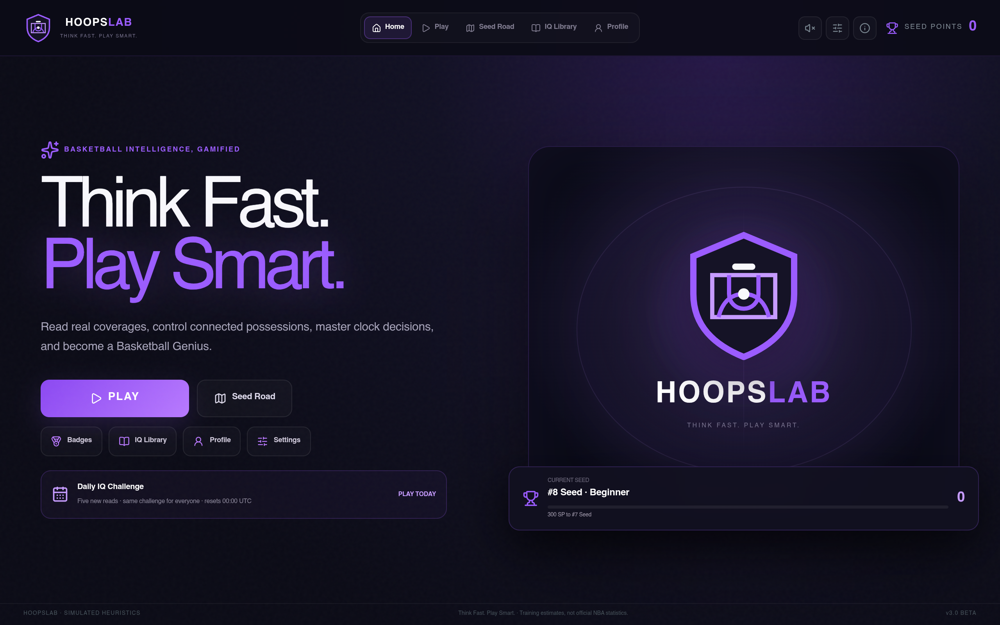
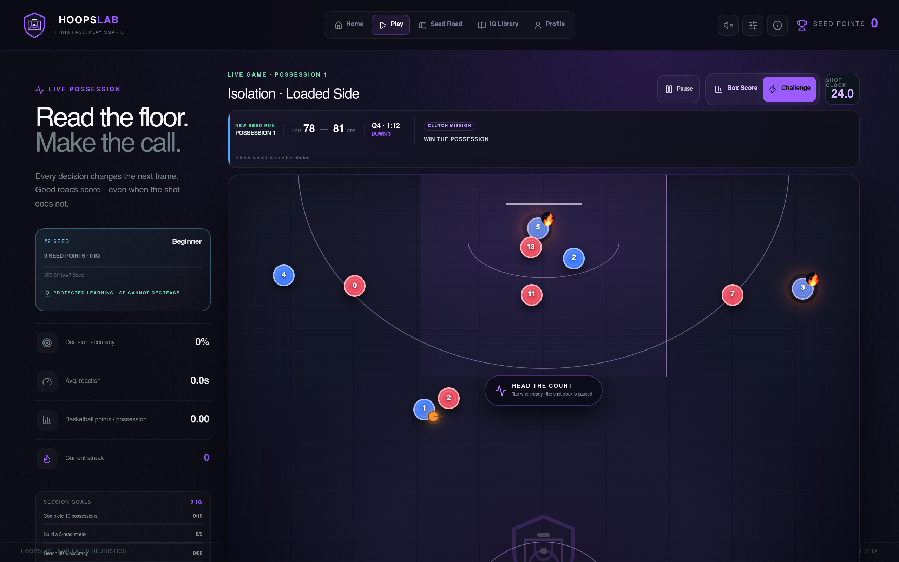
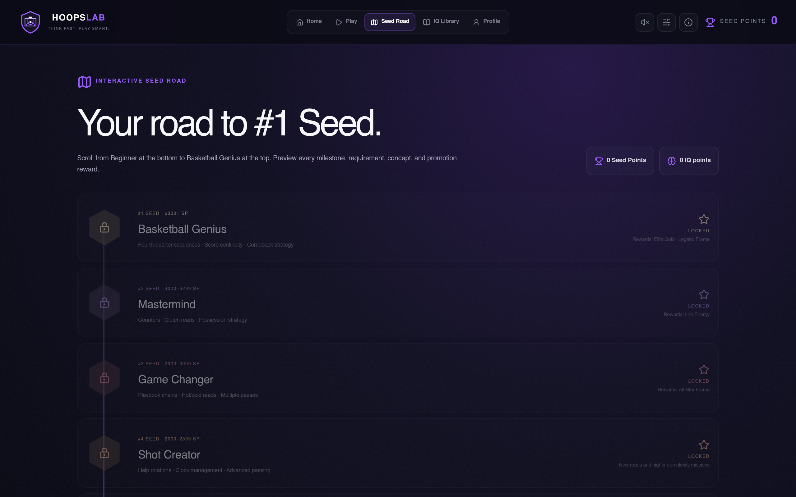
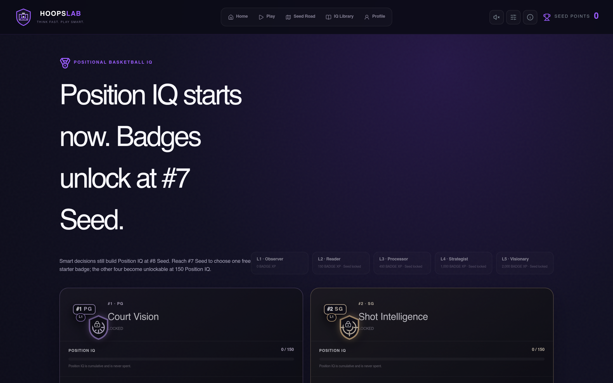

# HoopsLab

### Think Fast. Play Smart.

HoopsLab is a basketball IQ decision-making game built around realistic, connected possessions. Players read defensive coverages, control all five offensive players, manage the shot clock, and make tactical choices whose consequences carry into the next basketball situation.

> **Showcase repository**  
> This repository contains product documentation and demonstration screenshots only. The application source code, deployment configuration, credentials, and player data are intentionally not included.

**[Play the live beta →](https://hoopslab.vercel.app/)**

## Why it exists

Traditional basketball games reward stick skills, while quizzes reduce the sport to disconnected answers. HoopsLab focuses on the decisions between those extremes:

- Read the coverage before committing to an action.
- Create advantages through passing, movement, screening, rolling, and popping.
- Manage one shot clock across the entire connected possession.
- Separate decision quality from the final result.
- Learn why a smart read can miss—and why a poor read can still score.
- Develop position-specific basketball intelligence over time.

The goal is to make film-room thinking feel fast, interactive, and replayable.

## Product tour

### 1. Read a live basketball situation

Every possession begins with score, game clock, mission, spacing, player form, and a defensive coverage. The user analyzes the court before the shot clock starts, then controls the possession directly.

### 2. Make decisions that create the next situation

Passing, moving, shooting, or calling a screen changes player spacing and defensive reactions. Screeners can roll or pop, ball handlers relocate, and teammates re-space. The possession continues until a basket, miss and defensive rebound, turnover, defensive stop, offensive rebound, or shot-clock violation.

### 3. Climb the Seed Road

Progression runs from **#8 Seed · Beginner** to **#1 Seed · Basketball Genius**. Difficulty increases through more complex basketball concepts—not simply shorter timers. Seed Points determine rank, while IQ Points reward smart decision-making even when execution fails.

### 4. Develop positional basketball IQ

Each position builds its own Position IQ. At #7 Seed, the player chooses a starter badge; the remaining positional badges become unlockable through smart reads. Badge assistance fades as the player advances.

### 5. Play through one continuous game context

Score, quarter, game clock, roster form, fatigue, and box score carry across possessions within the same Seed run. This keeps a cold player, hot streak, comeback, or late-game situation grounded in the same game instead of feeling like a disconnected quiz.

### 6. Review the read separately from the result

HoopsLab evaluates the basketball decision and the possession outcome independently. A strong read can end in a miss or turnover; a low-value read can occasionally result in a made shot. Film Review preserves the sequence so the player can understand both.

## Core systems

| System | What it trains |
| --- | --- |
| Connected possessions | How one decision creates the next defensive reaction |
| Direct five-player control | Passing, movement, spacing, screening, rolling, and popping |
| Coverage recognition | Drop, switch, hedge, blitz, ICE, help, recovery, and rotation reads |
| Shot-clock management | Creating an advantage before the full-possession clock expires |
| Decision grading | Read quality independent from make, miss, or turnover |
| Seed progression | Increasing tactical complexity from Beginner to Basketball Genius |
| Position IQ and badges | Role-specific learning for PG, SG, SF, PF, and C |
| Live fictional roster | Form, fatigue, box score, and continuity across the same game |
| IQ Library | Basketball concepts and offensive-play movement previews |
| Daily IQ | A short repeatable challenge built around consistent reads |

## Gameplay loop

1. Read the game context, spacing, ball location, and defensive coverage.
2. Start the possession when the situation is understood.
3. Pass, move, shoot, or call a screen.
4. Watch teammates and defenders react to the choice.
5. Continue making connected decisions until the possession ends.
6. Review decision quality, outcome, IQ earned, badge progress, and Seed Points.
7. Continue the same Seed run or return home.

## Simulation and training model

HoopsLab uses configurable basketball-training heuristics rather than official NBA statistics.

- **Make %** estimates the probability of a shot going in.
- **TO %** estimates turnover risk.
- **Advantage %** estimates the chance of creating an offensive advantage.
- **ePPP** means estimated points per possession, not success probability.

Player attributes, openness, coverage, shot location, form, fatigue, score, time, previous actions, and positional badges can influence the simulated outcome. The values are designed for training and game balance, not statistical reporting.

## Progress and privacy

- Progress is stored locally in the player’s browser.
- Each browser or device keeps its own save unless data is manually transferred.
- The live beta does not require access to this repository.
- The public showcase contains no application source code, credentials, private tester list, or production secrets.
- Screenshots use fictional players and simulated basketball data.

## Important limitations

- HoopsLab is a basketball decision-training game, not a replacement for coaching, film study, or on-court practice.
- Probabilities are simulated heuristics and are not official NBA statistics.
- Outcomes remain probabilistic: correct decisions are not guaranteed to succeed.
- Local browser data can be lost if storage is cleared or the device changes.
- The product uses generic courts, fictional players, and original UI; no official NBA footage, logos, or team identities are included.
- Current player markers and fictional rosters are temporary presentation systems while final character artwork is developed.

## Project status

HoopsLab is a working public beta. The live build supports connected possessions, direct player control, shot-clock play, Seed progression, positional IQ, badges, fictional roster continuity, missions, box scores, tutorials, and mobile/desktop layouts.

**Live beta:** [https://hoopslab.vercel.app/](https://hoopslab.vercel.app/)

Source code, deployment instructions, credentials, and internal balance data are intentionally excluded from this showcase repository.

---

**HoopsLab**  
*Think Fast. Play Smart.*
